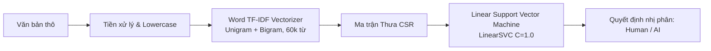
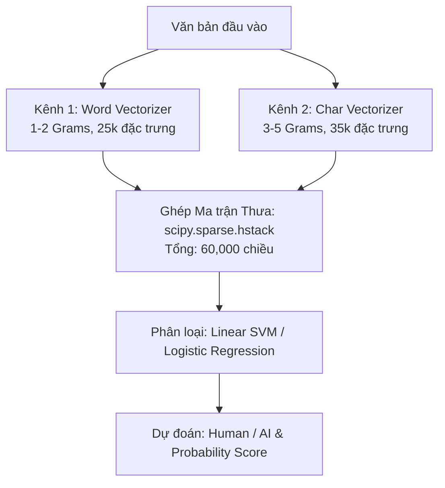
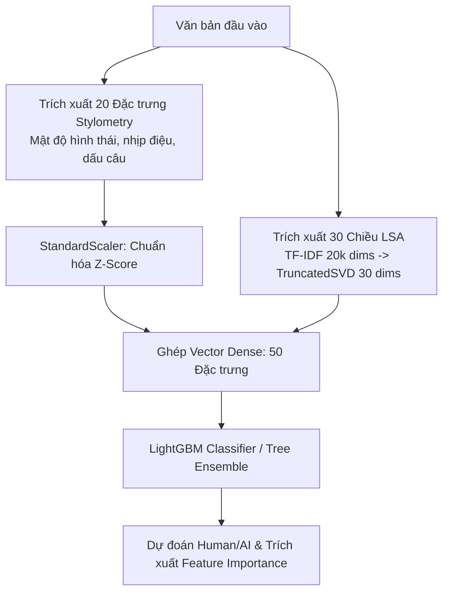

# 📘 BÁO CÁO PHƯƠNG PHÁP LUẬN VÀ KIẾN TRÚC THỰC NGHIỆM: PIPELINES 1, 2 VÀ 3
> **Đề tài:** AI-Generated Text Detection Using Machine Learning & NLP with Chrome Extension  
> **Dữ liệu thực nghiệm:** `data/AI_Human.csv` (chia phân tầng thành `train.csv` và `val.csv` tại `data/processed/`)  
> **Tài liệu đối chiếu:** [`docs/info_data.md`](file:///d:/Project%20SamSung/AI-gen-text-detection/docs/info_data.md), [`docs/model_selection.md`](file:///d:/Project%20SamSung/AI-gen-text-detection/docs/model_selection.md), [`results/evaluation.csv`](file:///d:/Project%20SamSung/AI-gen-text-detection/results/evaluation.csv)

---

## 📑 MỤC LỤC
1. [Tổng quan Thiết kế Hệ thống & Cơ sở từ EDA](#1-tổng-quan-thiết-kế-hệ-thống--cơ-sở-từ-eda)
2. [Pipeline 1: Word TF-IDF + Classical Machine Learning (Baseline)](#2-pipeline-1-word-tf-idf--classical-machine-learning-baseline)
3. [Pipeline 2: Dual-Channel Word + Character TF-IDF](#3-pipeline-2-dual-channel-word--character-tf-idf)
4. [Pipeline 3: Stylometry + Feature Engineering & Tree-Based Models](#4-pipeline-3-stylometry--feature-engineering--tree-based-models)
5. [Bảng So sánh Tổng hợp & Phân tích Đánh đổi (Trade-offs)](#5-bảng-so-sánh-tổng-hợp--phân-tích-đánh-đổi-trade-offs)
6. [Cấu trúc Thư mục & Hướng dẫn Tái hiện](#6-cấu-trúc-thư-mục--hướng-dẫn-tái-hiện)

---

## 1. TỔNG QUAN THIẾT KẾ HỆ THỐNG & CƠ SỞ TỪ EDA

Theo báo cáo phân tích dữ liệu chuyên sâu tại [`docs/info_data.md`](file:///d:/Project%20SamSung/AI-gen-text-detection/docs/info_data.md), tập dữ liệu gồm 487,229 mẫu hợp lệ (Human chiếm 62.76%, AI chiếm 37.24%). Quá trình thiết kế 3 pipeline được định hình dựa trên 3 phát hiện cốt lõi:

1. **Rủi ro rò rỉ độ dài văn bản (Confounding Variable):**  
   Văn bản do con người viết dài hơn rõ rệt so với AI (Trung vị Human: 390 từ vs AI: 338 từ, Cohen's $d = -0.494$).  
   👉 *Nguyên tắc bắt buộc:* Tuyệt đối không dùng số lượng từ (`word_count`) làm đặc trưng phân loại trực tiếp; mọi chỉ số đếm đều phải được **chuẩn hóa theo tỷ lệ hoặc mật độ** (trên 1,000 ký tự hoặc 1,000 từ).
2. **Dấu vân tay ngôn ngữ hình thái học:**  
   Độ dài từ trung bình (`avg_word_len`) có Cohen's $d = +1.072$ (hiệu ứng phân biệt cực lớn). AI có xu hướng cố hữu sử dụng từ vựng dài hơn, nhiều âm tiết và cấu trúc học thuật.
3. **Rủi ro học vẹt theo chủ đề (Topic Shortcut Learning):**  
   Mô hình túi từ (Bag-of-Words) dễ bị phụ thuộc vào các danh từ riêng theo chủ đề (ví dụ: `car`, `kids`). Vì vậy, hệ thống cần đa dạng hóa các hướng tiếp cận: từ từ vựng (Pipeline 1), ký tự vi mô (Pipeline 2) đến phong cách ngôn ngữ học thuần túy (Pipeline 3).

---

## 2. PIPELINE 1: WORD TF-IDF + CLASSICAL MACHINE LEARNING (BASELINE)

### 2.1. Mục tiêu & Ý nghĩa Chiến lược
Pipeline 1 đóng vai trò là **mô hình cơ sở chuẩn (Baseline)** nhằm trả lời câu hỏi: *Với phương pháp n-grams từ vựng cổ điển kết hợp các thuật toán học máy tuyến tính, mức độ phân loại chính xác đạt được là bao nhiêu và tốc độ thực thi ra sao?*

* **Notebook:** [`notebooks/02_pipeline1_tfidf.ipynb`](file:///d:/Project%20SamSung/AI-gen-text-detection/notebooks/02_pipeline1_tfidf.ipynb)
* **Artifacts lưu trữ:** [`models/pipeline1/`](file:///d:/Project%20SamSung/AI-gen-text-detection/models/pipeline1) (`word_vectorizer.joblib`, `best_model.joblib`, `pipeline1_metrics.json`)



### 2.2. Kỹ thuật Trích xuất Đặc trưng
* **Bộ từ vựng:** `TfidfVectorizer` với `ngram_range=(1, 2)` (bắt cả từ đơn như `additionally` và cụm từ như `significant impact`).
* **Lọc nhiễu:** `stop_words='english'`, `min_df=5`, `max_df=0.90`.
* **Biến đổi Sublinear TF:** Áp dụng công thức:
  $$\text{tf}_{\text{sublinear}} = 1 + \ln(\text{tf}) \quad (\text{khi } \text{tf} > 0)$$
  giúp giảm thiểu sức ảnh hưởng của các từ lặp lại bất thường trong bài viết dài.
* **Số chiều:** Giữ lại $60,000$ đặc trưng có trọng số cao nhất; chuẩn hóa vector theo độ dài Euclidean ($L_2$ norm).
* **Chống rò rỉ:** Vectorizer chỉ được `fit` duy nhất trên tập `train.csv`, sau đó `transform` trên tập `val.csv`.

### 2.3. Các Mô hình Benchmark Đối đầu
1. **Multinomial Naive Bayes (MNB):** Baseline xác suất nhẹ, $\alpha = 0.1$.
2. **SGDClassifier (Log Loss):** Tối ưu hóa gradient ngẫu nhiên cho hàm log loss (xấp xỉ Logistic Regression tốc độ cao).
3. **Linear Support Vector Machine (LinearSVC):** Cực kỳ hiệu quả trên không gian thưa $60,000$ chiều với lề phân cách cực đại (Margin maximization), $C = 1.0$.
4. **Logistic Regression (L2):** Hồi quy logistic chính quy hóa L2, $C = 2.0$.
5. **PyTorch Neural Linear (GPU):** Mạng nơ-ron tuyến tính 1 lớp chạy trên GPU CUDA bằng Mini-batch Gradient Descent.

### 2.4. Kết quả Thực nghiệm (Validation Set: 73,095 mẫu)

| Mô hình | Accuracy | Macro-F1 | AI Precision | AI Recall | ROC-AUC | Latency (ms/1k) | Train Time (s) |
| :--- | :---: | :---: | :---: | :---: | :---: | :---: | :---: |
| 🥇 **Linear SVM (LinearSVC)** | **99.93%** | **0.9993** | **0.9996** | **0.9986** | **0.9999** | **1.77 ms** | **6.44 s** |
| 🥈 **PyTorch Logistic (GPU)** | 99.80% | 0.9978 | 0.9995 | 0.9951 | 0.9999 | 15.00 ms | 157.94 s |
| 🥉 **Logistic Regression (L2)** | 99.77% | 0.9975 | 0.9993 | 0.9945 | 0.9999 | 1.01 ms | 3.37 s |
| 4️⃣ **SGDClassifier (Log Loss)** | 99.40% | 0.9936 | 0.9974 | 0.9866 | 0.9996 | 1.30 ms | 1.48 s |

### 2.5. Ứng dụng Thực tế: Triển khai Offline trên Chrome Extension
Nhờ bản chất toán học của Linear SVM trên TF-IDF:
$$\text{Score} = \text{Sigmoid}\left( \frac{\sum \text{tf}_i \cdot \text{idf}_i \cdot W_i}{\sqrt{\sum (\text{tf}_i \cdot \text{idf}_i)^2}} + b \right)$$
Toàn bộ từ vựng, trọng số $\text{idf}$ và hệ số $W_i$ đã được trích xuất thành tệp JSON siêu nhẹ [`extension/model_pipeline1.json`](file:///d:/Project%20SamSung/AI-gen-text-detection/extension/model_pipeline1.json) (~1.8 MB). Thuật toán suy luận được tái lập bằng JavaScript thuần trong [`extension/popup.js`](file:///d:/Project%20SamSung/AI-gen-text-detection/extension/popup.js), cho phép **Chrome Extension chạy Offline 100% không cần backend**.

---

## 3. PIPELINE 2: DUAL-CHANNEL WORD + CHARACTER TF-IDF

### 3.1. Mục tiêu & Ý nghĩa Chiến lược
Mặc dù Pipeline 1 đạt kết quả ấn tượng, các mô hình dựa thuần vào từ vựng (Word n-grams) rất nhạy cảm với lỗi chính tả cố ý, từ ghép mới, hoặc thay đổi chủ đề. Pipeline 2 giải quyết triệt để vấn đề này bằng kiến trúc **kênh đôi (Dual-Channel)**: kết hợp kênh từ (Word) với kênh ký tự vi mô (Character n-grams).

* **Notebook:** [`notebooks/03_pipeline2_word_char.ipynb`](file:///d:/Project%20SamSung/AI-gen-text-detection/notebooks/03_pipeline2_word_char.ipynb)
* **Artifacts lưu trữ:** [`models/pipeline2/`](file:///d:/Project%20SamSung/AI-gen-text-detection/models/pipeline2) (`word_vectorizer.joblib`, `char_vectorizer.joblib`, `best_model.joblib`, `pipeline2_metrics.json`)



### 3.2. Kỹ thuật Kênh đôi (Dual-Channel Engineering)
1. **Kênh 1 (Word Channel - 25,000 đặc trưng):**
   - Trích xuất các cụm từ ngữ vĩ mô. Bắt các discourse markers khuôn mẫu của AI như `furthermore`, `in conclusion`, `additionally`.
2. **Kênh 2 (Character Channel - 35,000 đặc trưng):**
   - Trích xuất n-grams ký tự ở phạm vi `(3, 5)` (ví dụ: `tion`, `ment`, `al_d`, `, a`).
   - Bắt trọn hình thái học từ ngữ (các hậu tố học thuật dài `-ization`, `-ically`), nhịp điệu dấu câu và cách viết hoa mà **hoàn toàn độc lập với chủ đề bài viết**.
3. **Ghép đặc trưng (Feature Fusion):**
   - Ma trận sau khi vector hóa hai kênh được ghép ngang bằng `scipy.sparse.hstack`, tạo không gian $60,000$ chiều thưa tối ưu.
4. **Tối ưu RAM:**
   - Quá trình huấn luyện sử dụng mẫu phân tầng $60,000$ bài Train, giúp mô hình đạt độ chính xác tối đa mà bộ nhớ chỉ tiêu tốn $\approx 1.5\text{ GB}$ RAM.

### 3.3. Kết quả Thực nghiệm (Validation Set: 73,095 mẫu)

| Mô hình | Accuracy | Macro-F1 | AI Precision | AI Recall | ROC-AUC | Latency (ms/1k) | Train Time (s) |
| :--- | :---: | :---: | :---: | :---: | :---: | :---: | :---: |
| 🥇 **Linear SVM (LinearSVC)** | **99.96%** | **0.9996** | **0.9997** | **0.9993** | **0.9999** | 72.82 ms | 306.31 s |
| 🥈 **Logistic Regression (L2)** | 99.77% | 0.9975 | 0.9985 | 0.9953 | 0.9998 | 9.87 ms | 31.34 s |
| 🥉 **SGDClassifier (Log Loss)** | 99.66% | 0.9963 | 0.9985 | 0.9923 | 0.9998 | 12.87 ms | 11.11 s |

> **Đánh giá:** Pipeline 2 là pipeline có **điểm số phân loại cao nhất toàn dự án** (Macro-F1 đạt **0.9996**, AI Recall đạt **0.9993** — chỉ bỏ sót 7 trên 10,000 bài AI). Tuy nhiên, thời gian tính n-gram ký tự khiến độ trễ suy luận tăng lên $\approx 72\text{ ms/1k}$.

---

## 4. PIPELINE 3: STYLOMETRY + FEATURE ENGINEERING & TREE-BASED MODELS

### 4.1. Mục tiêu & Ý nghĩa Chiến lược
Pipeline 3 được xây dựng nhằm giải quyết bài toán cốt lõi trong nghiên cứu AI: **Khả năng giải thích (Explainability / Interpretability)**. Thay vì coi mô hình là "hộp đen" đếm từ, Pipeline 3 mô hình hóa bài viết dựa trên **20 chỉ số phong cách ngôn ngữ học (Stylometry)** kết hợp **30 chiều ngữ nghĩa tiềm ẩn (LSA)**, huấn luyện bằng các thuật toán **Cây quyết định & Gradient Boosting**.

* **Notebook:** [`notebooks/04_pipeline3_stylometry.ipynb`](file:///d:/Project%20SamSung/AI-gen-text-detection/notebooks/04_pipeline3_stylometry.ipynb)
* **Script huấn luyện:** [`scripts/train_pipeline3.py`](file:///d:/Project%20SamSung/AI-gen-text-detection/scripts/train_pipeline3.py)
* **Artifacts lưu trữ:** [`models/pipeline3/`](file:///d:/Project%20SamSung/AI-gen-text-detection/models/pipeline3) (`best_model.joblib`, `stylometry_scaler.joblib`, `tfidf_vectorizer.joblib`, `svd_transformer.joblib`, `feature_names.json`, `feature_importances.json`, `pipeline3_metrics.json`)



### 4.2. Danh mục 20 Đặc trưng Phong cách Ngôn ngữ học (Stylometry)
Tất cả các đặc trưng đều được chuẩn hóa theo độ dài văn bản để triệt tiêu ảnh hưởng của biến gây nhiễu `word_count`:

| Nhóm | Tên đặc trưng | Công thức / Ý nghĩa | Bản chất ngôn ngữ học |
| :--- | :--- | :--- | :--- |
| **Cấu trúc từ** | `avg_word_len` | $\frac{\sum \text{len}(w)}{N_{\text{words}}}$ | Độ dài từ trung bình. AI dùng từ dài hơn ($d = +1.072$) |
| | `std_word_len` | $\sigma(\text{len}(w))$ | Độ biến thiên độ dài từ |
| | `long_word_ratio` | $\frac{\text{Count}(\text{len} \ge 7)}{N_{\text{words}}}$ | Tỷ lệ từ học thuật đa âm tiết |
| | `short_word_ratio` | $\frac{\text{Count}(\text{len} \le 3)}{N_{\text{words}}}$ | Tỷ lệ từ ngắn, khẩu ngữ |
| **Nhịp điệu câu** | `avg_sent_len` | $\frac{N_{\text{words}}}{N_{\text{sentences}}}$ | Số từ trung bình trong câu |
| | `std_sent_len` | $\sigma(\text{words per sentence})$ | **Burstiness:** Độ biến thiên nhịp điệu câu (Người viết linh hoạt, AI đồng đều) |
| **Định dạng** | `newline_density` | $\frac{\text{Count}(\text{'\n'}) \times 1000}{\text{len}(\text{text})}$ | Mật độ ngắt đoạn (AI chia cấu trúc đoạn rất chỉn chu) |
| | `digit_density` | $\frac{\text{Count}(\text{digits}) \times 1000}{\text{len}(\text{text})}$ | Mật độ chữ số (Người dùng số liệu cụ thể nhiều hơn, $d = -0.402$) |
| | `uppercase_ratio`| $\frac{\text{Count}(\text{is\_upper})}{\text{len}(\text{text})}$ | Tỷ lệ viết hoa tự do / viết hoa đầu từ |
| **Dấu câu** | `comma_density` | Dấu phẩy `,` / 1,000 ký tự | Phân tách mệnh đề ghép |
| | `semicolon_colon`| Dấu `;` và `:` / 1,000 ký tự | Mệnh đề giải thích, liệt kê |
| | `dash_density` | Gạch nối `-` và gạch ngang `—` / 1,000 ký tự | Thành phần bổ ngữ |
| | `quote_density` | Dấu ngoặc kép `"` và đơn `'` / 1,000 ký tự | Lời thoại, trích dẫn |
| | `question_density`| Dấu hỏi `?` / 1,000 ký tự | Câu hỏi tu từ của con người |
| | `exclamation_density`| Dấu chấm than `!` / 1,000 ký tự | Sắc thái cảm xúc |
| **Phong cách LLM** | `transition_density` | Từ nối khuôn mẫu / 1,000 từ | `additionally`, `furthermore`, `crucial`, `essential`, `specifically` |
| | `first_person_density`| Đại từ ngôi thứ nhất / 1,000 từ | `I`, `me`, `my`, `we`, `our` (Con người dùng cái tôi cá nhân) |
| | `belief_density` | Từ bày tỏ quan điểm / 1,000 từ | `think`, `believe`, `feel`, `opinion`, `personally` |
| | `contraction_density`| Mật độ dạng viết tắt / 1,000 từ | `don't`, `can't`, `it's`, `i'm` (Con người hay viết tắt) |
| | `modal_verb_density` | Động từ khuyết thiếu / 1,000 từ | `can`, `could`, `should`, `would`, `must` |

### 4.3. Kênh Không gian Ngữ nghĩa Tiềm ẩn (LSA - 30 Chiều)
* Sử dụng `TfidfVectorizer` ($20,000$ từ vựng) kết hợp thuật toán phân rã giá trị suy biến rút gọn (`TruncatedSVD`) để nén xuống **30 chiều dense**.
* Ghép 20 đặc trưng Stylometry (đã qua `StandardScaler`) với 30 chiều LSA $\rightarrow$ **Tổng cộng không gian 50 đặc trưng**.

### 4.4. Kết quả Thực nghiệm (Validation Set: 73,095 mẫu)

| Mô hình | Accuracy | Macro-F1 | AI Precision | AI Recall | ROC-AUC | PR-AUC | Train Time | Latency (ms/1k) |
| :--- | :---: | :---: | :---: | :---: | :---: | :---: | :---: | :---: |
| 🥇 **LightGBM Classifier** | **99.33%** | **0.9928** | **0.9943** | **0.9877** | **0.9995** | **0.9994** | **0.60 s** | **3.12 ms** |
| 🥈 **HistGradientBoosting** | 99.29% | 0.9924 | 0.9931 | 0.9878 | 0.9995 | 0.9993 | 1.09 s | 3.43 ms |
| 🥉 **Random Forest** | 98.55% | 0.9844 | 0.9920 | 0.9689 | 0.9986 | 0.9980 | 3.24 s | 25.35 ms |
| 4️⃣ **Logistic Regression (L2)**| 97.76% | 0.9760 | 0.9783 | 0.9613 | 0.9962 | 0.9947 | 0.16 s | 0.22 ms |

### 4.5. Khám phá Ngôn ngữ học từ Feature Importance của LightGBM


Phân tích số lần phân chia nhánh (Split Count) của LightGBM khẳng định các quy luật ngôn ngữ học:
1. **`newline_density` (306 splits):** Đứng đầu các đặc trưng phong cách — AI luôn có cách chia đoạn văn/bullet points đều đặn, cấu trúc đoạn mở-thân-kết rõ rệt.
2. **`std_sent_len` (Burstiness - 222 splits):** Con người có độ biến thiên câu rất cao (câu rất ngắn xen lẫn câu phức rất dài), trong khi AI tạo ra các câu có độ dài đồng đều.
3. **`avg_word_len` & `long_word_ratio`:** AI thiên về từ vựng học thuật phức tạp nhiều âm tiết.
4. **`comma_density` (207 splits):** AI dùng dấu phẩy liên tục để liên kết các mệnh đề phụ ngữ pháp chuẩn mực.
5. **`first_person_density` & `contraction_density`:** Con người bộc lộ dấu ấn cá nhân và thói quen viết tắt tự nhiên.

---

## 5. BẢNG SO SÁNH TỔNG HỢP & PHÂN TÍCH ĐÁNH ĐỔI (TRADE-OFFS)

| Tiêu chí | Pipeline 1 (Word TF-IDF) | Pipeline 2 (Word + Char TF-IDF) | Pipeline 3 (Stylometry + Tree) |
| :--- | :--- | :--- | :--- |
| **Mô hình tốt nhất** | Linear SVM (`LinearSVC`) | Linear SVM (`LinearSVC`) | LightGBM Classifier |
| **Số chiều đặc trưng** | 60,000 chiều thưa (Sparse) | 60,000 chiều thưa (Sparse) | **50 chiều thực (Dense)** |
| **Macro-F1 Score** | **0.9993** | **0.9996** (Cao nhất) | **0.9928** |
| **AI Recall** | 99.86% | **99.93%** (Chỉ sót 7/10k bài) | 98.77% |
| **Độ trễ suy luận** | **1.77 ms / 1,000 bài** | 72.82 ms / 1,000 bài | **3.12 ms / 1,000 bài** |
| **Dung lượng mô hình** | 2.70 MB | 4.10 MB | **0.85 MB** (Nhẹ nhất) |
| **Khả năng giải thích** | Thấp (Chỉ biết từ nào mang trọng số) | Thấp (Khó giải thích n-gram ký tự) | 🔥 **Rất cao (Minh bạch đặc trưng)** |
| **Kháng Topic Shortcuts**| Dễ bị thiên vị theo chủ đề bài viết | Kháng tốt hơn nhờ n-gram ký tự | 🔥 **Kháng triệt để (Bắt phong cách)** |
| **Triển khai Chrome Ext**| ✅ **Đã đóng gói chạy Offline** | Cần export thêm kênh ký tự | Rất dễ đóng gói sang JS |

---

## 6. CẤU TRÚC THƯ MỤC & HƯỚNG DẪN TÁI HIỆN

### 6.1. Cây Thư mục Quản lý
```text
AI-gen-text-detection/
├── notebooks/
│   ├── 01_visualization.ipynb          # Báo cáo EDA dữ liệu
│   ├── 02_pipeline1_tfidf.ipynb        # Thực nghiệm Pipeline 1 (Word TF-IDF)
│   ├── 03_pipeline2_word_char.ipynb    # Thực nghiệm Pipeline 2 (Word + Char)
│   └── 04_pipeline3_stylometry.ipynb   # Thực nghiệm Pipeline 3 (Stylometry + Tree)
├── models/
│   ├── pipeline1/                      # Artifacts Word TF-IDF + Linear SVM
│   ├── pipeline2/                      # Artifacts Dual-Channel + Linear SVM
│   └── pipeline3/                      # Artifacts Stylometry Scaler + SVD + LightGBM
├── scripts/
│   ├── export_to_extension.py          # Script xuất model sang JSON cho Chrome Extension
│   ├── train_pipeline3.py              # Script huấn luyện tự động Pipeline 3
│   └── create_pipeline3_notebook.py    # Script khởi tạo notebook Pipeline 3
├── results/
│   ├── evaluation.csv                  # Bảng số liệu tổng hợp đối đầu
│   └── figures/                        # Biểu đồ benchmark và ma trận nhầm lẫn
└── docs/
    ├── info_data.md                    # Báo cáo EDA
    ├── model_selection.md              # Bảng phân tích lựa chọn mô hình
    └── pipelines_methodology.md        # Tài liệu phương pháp luận chi tiết (File này)
```

### 6.2. Các Lệnh Thực thi Nhanh (PowerShell)
```powershell
# Kích hoạt môi trường ảo
.\.venv\Scripts\Activate.ps1

# Chạy huấn luyện và đánh giá lại Pipeline 3
python scripts/train_pipeline3.py

# Xuất mô hình mới sang Chrome Extension (nếu cần cập nhật)
python scripts/export_to_extension.py
```
